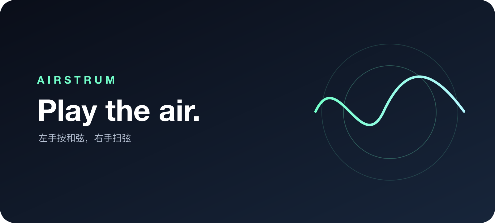

# AirStrum



> **Play the air. / 弹奏空气。**

AirStrum is a native Swift iPhone + Apple Watch instrument. Hold a chord on
your iPhone with one hand and strum with the Watch on the other wrist.
It is designed for immediate, playful sound rather than a traditional guitar
simulator.

AirStrum 是一个原生 Swift iPhone + Apple Watch 体感乐器。用一只手在 iPhone
上按住和弦，用另一只手佩戴 Apple Watch 扫弦。它追求即时、好玩的声音反馈，
而不是模拟一把完整的真实吉他。

## Current build / 当前版本

- Native SwiftUI UI for iOS and watchOS / iOS 与 watchOS 原生 SwiftUI 界面
- Watch-side Core Motion strum detection / 手表端 Core Motion 扫弦识别
- WatchConnectivity live messages / WatchConnectivity 实时消息
- Hold-to-play chord interaction / 按住和弦才发声
- Programmatically generated chord tones with short natural decay / 程序生成和弦音色与短尾音衰减
- Down-strum and up-strum direction / 下扫与上扫方向

This is an early personal prototype. Motion thresholds and audio feel must be
tuned on a real paired iPhone and Apple Watch. The simulator cannot validate
the physical strum experience.

这是一个早期个人原型。动作阈值和声音手感必须在真实配对的 iPhone 与 Apple
Watch 上调试；模拟器无法验证真实扫弦体验。

## Interaction / 交互

1. Install and open AirStrum on iPhone and Apple Watch.
2. Allow motion access if requested; audio playback does not require microphone access.
3. Keep a chord button pressed on iPhone.
4. Tap **STRUM** on the Watch to begin motion detection.
5. Strum down or up with the Watch hand.
6. Release the chord button to fade the current chord out.

1. 在 iPhone 与 Apple Watch 上安装并打开 AirStrum。
2. 按提示允许动作访问；音频播放不需要麦克风权限。
3. 在 iPhone 上按住一个和弦按钮。
4. 在手表上点击 **STRUM** 开始动作识别。
5. 佩戴手表的手向下或向上扫动。
6. 松开 iPhone 和弦按钮，让当前和弦衰减消失。

## Build / 构建

Requirements: iOS 17+, watchOS 10+, a paired iPhone/Watch, and Xcode with the
Apple license accepted and the relevant SDKs installed. The checked-in project
can be opened directly; XcodeGen is needed only to regenerate its configuration.

要求：iOS 17+、watchOS 10+、配对的 iPhone/Watch，以及已接受 Apple 许可、安装
对应 SDK 的 Xcode。可直接打开仓库中的工程，仅重新生成工程配置时需要 XcodeGen。

The repository uses XcodeGen to keep the project definition readable.

```bash
brew install xcodegen
xcodegen generate
open AirStrum.xcodeproj
```

Then select an iPhone and its paired Apple Watch in Xcode and run the iOS
scheme. Set your own Signing Team in the two targets.

仓库使用 XcodeGen，让工程配置保持可读：

```bash
brew install xcodegen
xcodegen generate
open AirStrum.xcodeproj
```

然后在 Xcode 中选择 iPhone 及其配对的 Apple Watch，运行 iOS scheme，并在两个
target 中设置自己的签名 Team。

## Architecture / 架构

```text
iPhone SwiftUI
  ├─ held chord state
  ├─ AVAudioEngine chord voice
  └─ WatchConnectivity session
          ↕ live strum events
Apple Watch SwiftUI
  └─ Core Motion → down/up + velocity
```

The watch sends compact motion events; the phone remains the source of chord
state and audio output. No network service is required.

手表只发送紧凑的动作事件；iPhone 负责和弦状态与声音输出。不需要服务器。

## License / 许可证

Personal prototype. Add a project-specific license before public distribution.

个人原型项目。如需公开分发，请先补充项目专用许可证。

## Verification and limits / 验证与限制

Run from the repository root on macOS with the installed Swift compiler and SDKs:

在安装了 Swift 编译器和 SDK 的 macOS 上，从仓库根目录运行：

```bash
bash Scripts/check-audio.sh
bash Scripts/check-connectivity.sh
```

Audio checks render the production engine offline on macOS, excluding iOS-only
audio-session setup. Connectivity checks use explicit hardware mocks. Neither
proves paired-device latency, reliable wrist direction, background execution,
or listening quality. Keep both apps active while evaluating the instrument;
the Watch does not play audio and does not have an audio-background entitlement.
Bluetooth headphone output may add latency; compare with the iPhone speaker or
a wired output when measuring responsiveness.

音频检查在 macOS 离线渲染实际引擎，不包含 iOS 专属音频会话配置。连接检查使用
明确的硬件模拟。两者均不能证明配对真机延迟、手腕方向准确性、后台运行或听感。
评估时请保持双端应用活跃；手表不播放音频，也不以后台音频模式保活。蓝牙耳机
可能增加输出延迟，测量跟手感时请与手机扬声器或有线输出对比。

The project-local SwiftUI guidance is installed under
`.agents/skills/swiftui-expert-skill` from
[AvdLee/SwiftUI-Agent-Skill](https://github.com/AvdLee/SwiftUI-Agent-Skill).
Its guidance does not replace device testing.

已安装项目级原生 SwiftUI 指导 skill，路径和来源如上；它不能替代真机测试。
